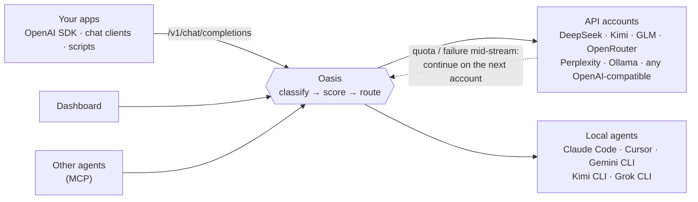

<div align="center">

# Oasis

**One local endpoint for every AI account and coding agent you already pay for.**

Oasis picks the right model or agent for each request.
When an account runs out of quota halfway through an answer, it hands the stream to the next one. Your client never notices.

**English** · [简体中文](README.zh-CN.md)

🗂️ [Highlights](#five-things-it-takes-on) · 🚪 [Ways in](#ways-to-use-it) · 🚀 [Quick start](#quick-start) · ⚙️ [Configuration](#configuration)

</div>


## Five things it takes on

### 🗂️ Manage as one

> Accounts live in separate consoles, separate CLIs, and a pile of environment variables.

One local process gathers the API accounts and the local agents into one config and one setup page. The first start finds the keys, the running Ollama, and the installed agents, tests each one, and marks it ✅ working, ⏳ out of quota, or 🚫 rejected or unreachable. You tick what stays. 🔑 Keys stay in the environment, in `export` lines of `~/.bashrc` or `~/.zshrc`, or in an owner-only `secrets.env`. They are not written into the config, and they are not passed to agents.

### 👀 See as one

> The work is scattered across chat windows, and afterwards you cannot see why that path was taken.

The dashboard gathers a task into one place: the routing explanation, the live steps, the files it produced, the follow-up, and the stop button. If the account changes halfway through a stream, you still read one answer, and the switch is recorded on that task. The self-test cuts a stream on purpose and checks that no words were repeated.

### 🎯 Choose freely

> Each agent is its own app. A task is locked inside one, or you change windows yourself.

Let Oasis choose, or name an agent, or name a model. Ask a question, or send the work to a local agent that edits files and runs commands. Up to three accounts can answer the same question, and one merged reply shows where they agree and where they do not. The goal can be ⚖️ balanced, ⚡ fastest, 🏆 best, or 💸 cheapest. A follow-up resumes that agent's own session, in that conversation's directory.


### 💰 Spend clearly

> What this month cost, and what each provider has left, means opening each billing page.

Every account shows this month's spend next to its monthly budget. Every routing decision writes the cost term beside fit, speed, and load. With the goal set to cheapest, cost is seventy percent of the score. A daily cap, a per-minute limit, or a monthly budget is a hard stop: an account past it is not chosen. A model with no price yet keeps a neutral cost term, so it is not preferred for being free.

### 🧩 Expand freely

> A new provider or a new agent usually means another tool.

An account is an OpenAI-compatible endpoint or an Anthropic endpoint. An agent is a local command. The built-in 13 providers and 6 agents are ready-made entries. Paste a key on the setup page, or add a block to the config, and you have one more. Other programs can also connect over MCP to ask a model or hand off a task.

## Ways to use it

The five above are what Oasis takes on. Below is where you walk into the same gateway. Examples follow.

- 🖥️ **Dashboard** — open `http://127.0.0.1:9899/`, type a task, watch the route and the live steps, then follow up, stop, or delete.
- 🔌 **OpenAI API** — point any SDK or chat app at `http://127.0.0.1:9899/v1` and set `model` to `auto`. Streaming and one-shot both work.
- ⌨️ **Terminal** — `scripts/oasis.sh ask "..." --stream`, or `scripts/oasis.sh models`.
- 🛠️ **Local agent** — send `X-Oasis-Mode: agent`. Oasis picks an installed agent, or you name one with `X-Oasis-Agent`.
- 👥 **Committee** — send `X-Oasis-Committee` with up to three accounts. One merged answer shows where they agree and where they do not.
- 🤝 **MCP** — other agents call `POST /mcp` to ask a model, hand work to your local agents, or leave a message for each other.

## Why Riot and OCaml

All of the state stays in `~/.oasis` on your machine. There is no database to run, and no runtime to keep alive beside it.

- 📦 **Under 10 MB.** One binary serves the API, the dashboard, the event stream, and MCP.
- ⚡ **About 2 µs** to score a route, so every request is scored again. Oasis does not reuse a cached choice.
- 🧵 **Each stream is its own actor.** When an account fails mid-answer, late bytes from the old connection are dropped and the next account continues. Latency, circuit breakers, and in-flight counts live in shared concurrent maps, so the next request sees the failure.

A supervision tree that restarts a crashed agent is still ahead. Today the boundary is one actor per request. [docs/oasis-spec.md](docs/oasis-spec.md) §1.4 records what is already true and what is not.

## How a request moves



## Quick start

Paste this to your coding agent (Cursor, Claude Code, Codex, or any agent that can run commands). The agent reads that page first and only then installs anything, including cloning this repository:

> Read https://raw.githubusercontent.com/vajraimb/oasis/main/docs/agent-setup.md from the top and do what it says. Do not clone or install anything until that document tells you to. Stop when it says the console is open.

On a machine with nothing installed, the agent follows https://riot.ml to install Riot, clones this repository, builds, starts Oasis, and opens the console. A setup page lists what it found; you tick what you want and press Save. You do not edit a config file, and you do not paste API keys into the chat.

Or do it yourself. You need macOS or Linux and the [Riot](https://github.com/leostera/riot) OCaml toolchain.

```bash
curl -sSL https://get.riot.ml | sh                 # install Riot, from https://riot.ml
export PATH="$HOME/.riot/bin:$PATH"
git clone https://github.com/vajraimb/oasis.git && cd oasis
riot toolchain install                             # the OCaml compiler pinned by this repo
riot plan > /dev/null && scripts/patch-riot.sh      # two runtime fixes for Riot 0.0.43
riot build
scripts/oasis.sh --self-test                        # no API keys needed
```

The self-test starts mock upstreams and runs four end-to-end checks: routing, falling back after a `429`, streaming, and a stream that is cut mid-answer and finished by another account with zero duplicated text.

Then start it for real:

```bash
scripts/oasis.sh start                              # first start detects your accounts and agents
open http://127.0.0.1:9899/                         # the setup page opens by itself
```

On the first start Oasis writes `~/.oasis/oasis.toml` from what it finds:

- API keys in your environment for 13 providers: DeepSeek, Kimi, GLM, OpenRouter, Perplexity, Qwen (DashScope), OpenAI, Anthropic, Gemini, xAI, Groq, Mistral and SiliconFlow. The standard names such as `DEEPSEEK_API_KEY` and `OPENROUTER_API_KEY` are found, and so are your own names like `glm_work_key`. Each key is tested live, and for providers with several endpoints (Kimi Coding vs. Moonshot, China vs. international) Oasis keeps the one that works;
- local and cloud models in a running Ollama;
- Claude Code, Cursor Agent, Gemini CLI, Kimi CLI and Grok CLI, if installed.

The setup page in the dashboard then shows each account's status: works, rate limited, out of quota, invalid key or unreachable. Untick anything you don't want, paste keys for providers you haven't set up yet, choose a routing goal and press **Save & start**. You can reopen it any time from the **Setup** button. It edits your existing config in place: hand-written entries, comments and tuned values stay as they are, and the previous version is kept as `oasis.toml.bak`. The page is in English or Chinese, following your browser.

Prefer a file? Copy [`config/oasis.example.toml`](config/oasis.example.toml) to `~/.oasis/oasis.toml` before the first start, and Oasis won't generate one.

`scripts/oasis.sh` also has `stop`, `restart`, `status` and `logs`. Any other arguments are passed to the `oasis` binary, so `scripts/oasis.sh ask "hello" --stream` and `scripts/oasis.sh models` work too.

## Use it from anything

**curl**

```bash
curl -N http://127.0.0.1:9899/v1/chat/completions \
  -H 'Content-Type: application/json' \
  -H 'X-Oasis-Goal: cheapest' \
  -d '{"model": "auto", "messages": [{"role": "user", "content": "Explain CRDTs in two sentences"}], "stream": true}'
```

**OpenAI SDK (Python)**

```python
from openai import OpenAI

client = OpenAI(base_url="http://127.0.0.1:9899/v1", api_key="unused")
reply = client.chat.completions.create(
    model="auto",  # or a configured model name to pin it
    messages=[{"role": "user", "content": "Write a haiku about failover"}],
    extra_headers={"X-Oasis-Goal": "best"},
)
print(reply.choices[0].message.content)
```

**Hand a real task to a local agent**

```bash
curl -N http://127.0.0.1:9899/v1/chat/completions \
  -H 'Content-Type: application/json' -H 'X-Oasis-Mode: agent' \
  -d '{"model": "auto", "stream": true, "messages": [{"role": "user",
       "content": "Build a CLI that compares tomorrow'\''s forecast from three weather APIs"}]}'
```

The response carries an `X-Oasis-Thread` header. Send it back with your next message, and the same agent continues in the same working directory.

### Request headers

All headers are optional. Without them, Oasis decides from the content.

| Header | Effect |
|---|---|
| `X-Oasis-Mode` | `chat` or `agent` |
| `X-Oasis-Category` | `coding`, `research`, `writing`, `analysis` or `general` |
| `X-Oasis-Goal` | `balanced`, `fastest`, `best` or `cheapest` |
| `X-Oasis-Agent` | run on a specific agent |
| `X-Oasis-Committee` | comma-separated accounts that answer together |
| `X-Oasis-Thread` | continue a conversation |
| `X-Oasis-Timeout` | time limit in seconds; by default the task runs until it finishes or you stop it |

Setting `model` to `auto`, `oasis` or leaving it empty lets Oasis route. A model name from your config pins that model.

## Configuration

Everything lives in `~/.oasis/oasis.toml`. [`config/oasis.example.toml`](config/oasis.example.toml) is a commented starting point covering models, accounts and every supported agent. It declares three kinds of things:

- **models**: what each model is good at, its context window, latency and price;
- **accounts**: an endpoint, the environment variable holding its key, the models it serves, and its rate limits and budget;
- **agents**: a CLI command and the arguments that run it headless.

Routes then say which accounts may serve each category. The setup page writes all of this for you. If you edit the file by hand, `POST /api/reload` or restart.

Runtime files:

```
~/.oasis/                  (override with OASIS_HOME)
├── oasis.toml             config
├── secrets.env            keys pasted into the setup page (mode 0600, loaded at startup)
├── data/                  conversations, routing decisions, cost ledger, learned quality and latency
├── workspaces/<thread>/   one working directory per conversation; agent output lands here
└── logs/oasis.log
```

By default Oasis listens on `127.0.0.1` only. Before exposing it on a network, set `auth_token_env` so that every request needs a Bearer token; Oasis refuses to start on a non-loopback address without one. Agents run with the permissions of your user account, so only give them tasks you would run yourself.

## Status

Oasis is young and runs daily as a single-user, single-machine gateway. Things to know:

- The dashboard and the CLI output are in Chinese. The setup page follows the browser language. The API is language-neutral.
- Running the test suite in parallel occasionally crashes inside the Riot runtime, so run it serially (see below).
- [docs/oasis-spec.md](docs/oasis-spec.md), written in Chinese, documents the scheduling algorithm, the handoff state machine, security boundaries, persistence semantics and known limitations in detail.

Issues and pull requests are welcome.

## License

[MIT](LICENSE). Use it, change it, ship it. The Riot kernel and standard library Oasis builds against are Apache-2.0.

## Development

```bash
riot build
riot test -p oasis -- --concurrency 1   # gateway tests, serially
riot test -p oasis_net
riot bench -p oasis
bash scripts/build-release.sh           # release binary in dist/
```

```
packages/
├── net/       oasis_net: TCP pool (Atacama), HTTP/1.1 + WebSocket (Nomad), middleware and router (Trail)
└── oasis/     the gateway: src/oasis_*.ml, tests/, bench/, examples/ (mock upstream, HTTPS probe)
config/        oasis.example.toml, oasis-demo.toml (keyless demo against local mocks)
scripts/       oasis.sh, build-release.sh, patch-riot.sh
docs/          agent-setup.md is the runbook a coding agent follows to install Oasis and open the console
patches/riot/  Riot kernel/std patches applied by CI and local builds
```
