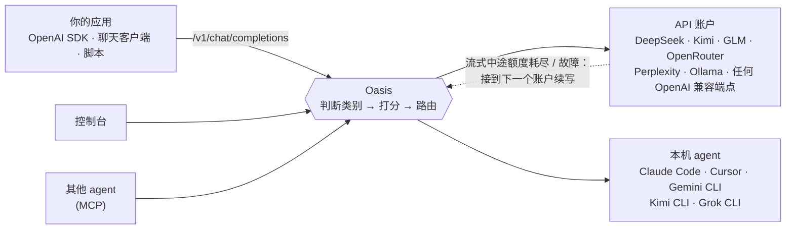

<div align="center">

# Oasis

**把你手上所有的 AI 账户和 coding agent，收进本机的一个入口。**

每个请求，Oasis 都替你挑最合适的模型或 agent。
账户回答到一半额度用完了，流接到下一家，客户端完全感觉不到。

[English](README.md) · **简体中文**

🗂️ [特点](#五个特点) · 🚪 [用法](#几种用法) · 🚀 [快速开始](#快速开始) · ⚙️ [配置](#配置)

</div>


## 五个特点

### 🗂️ 集中管

> 账户散在各家后台、命令行和环境变量里。

一个本机进程收口：API 账户和本机 agent 在同一份配置、同一个设置页。第一次启动会把已有的 key、正在运行的 Ollama、已安装的 agent 找出来并实测，标明 ✅ 能用、⏳ 额度用完、🚫 key 无效或连不上。留下哪些，勾选即可。🔑 留在环境变量里、`~/.bashrc` 或 `~/.zshrc` 的 `export` 行里，或留在只有你能读的 `secrets.env`；不写进配置，也不传给 agent。

### 👀 统一看

> 活散在各个聊天窗口里，做完了也不知道为什么走了那条路。

控制台按任务收拢：路由说明、实时步骤、产出文件、追问和停止，都在这一条上。流式写到一半换了账户，你看到的仍是一条回答，切换记在这条任务里。自检会故意切断一条流，并检查有没有重复的字。

### 🎯 自由选

> 每个 agent 都是一个单独的应用，任务要么锁在里面，要么你自己换窗口。

可以交给 Oasis 选，也可以指定一个 agent 或一个模型；可以只问答，也可以让本机 agent 去改文件、跑命令。最多三个账户可以同时答同一题，再合成一份，写出共识和分歧。目标可以换成 ⚖️ 均衡、⚡ 最快、🏆 质量优先或 💸 最省钱。选定之后，追问会接着那个 agent 自己的会话，在这个对话自己的目录里继续。


### 💰 明白花

> 这个月花在哪、哪家还剩多少，要打开各家账单才知道。

每个账户在控制台里有本月花费和月预算。每次路由都把成本与适配、速度、负载写在同一条决策说明里。目标选最省钱时，成本占打分的七成。日限额、每分钟次数和月预算是硬界限，超了的账户不会被选中。模型还没填价格时，成本项保持中性，不会被当成免费而优先选中。

### 🧩 任意扩

> 新加一家服务商或一个 agent，往往意味着再装一个工具。

账户就是一个 OpenAI 兼容端点或 Anthropic 端点，agent 就是一条本机命令。内置的 13 家服务商和 6 个 agent 只是现成项。设置页粘一个 key，或在配置里加一段，就多一个。别的程序还可以通过 MCP 接进来问模型、派任务。

## 几种用法

上面五条是 Oasis 替你承担的事。下面是你从哪里走进同一个网关，例子在后文。

- 🖥️ **控制台** — 打开 `http://127.0.0.1:9899/`，输入任务，看路由和实时步骤，然后追问、停止或删除。
- 🔌 **OpenAI 接口** — 任何 SDK 或聊天应用把地址指到 `http://127.0.0.1:9899/v1`，`model` 填 `auto`。流式和一次性都支持。
- ⌨️ **终端** — `scripts/oasis.sh ask "..." --stream`，或者 `scripts/oasis.sh models`。
- 🛠️ **本机 agent** — 带上 `X-Oasis-Mode: agent`。Oasis 选一个已安装的 agent，也可以用 `X-Oasis-Agent` 指定。
- 👥 **委员会** — `X-Oasis-Committee` 最多三个账户同时作答，汇总成一份，标明共识和分歧。
- 🤝 **MCP** — 别的 agent 调用 `POST /mcp`，用来问模型、把活交给你的本机 agent，或互相留言。

## 为什么是 Riot 和 OCaml

状态都在你机器上的 `~/.oasis`。没有要另起的数据库，也没有要另养的运行时。

- 📦 **不到 10 MB**，一个二进制里装着 API、控制台、事件流和 MCP。
- ⚡ **大约 2 微秒**一次路由，所以每个请求都重新打分，不沿用上一次的选择。
- 🧵 **每条流是一个 actor**。账户写到一半失败时，旧连接迟到的字节会被丢掉，下一个账户接上。时延、熔断和正在处理的请求数放在共享的并发表里，下一个请求能看见这次失败。

自动拉起崩溃 agent 的监督树还在后面。现在的边界是一个请求一个 actor。[docs/oasis-spec.md](docs/oasis-spec.md) §1.4 写了哪些已经做到、哪些还没有。

## 一次请求怎么走



## 快速开始

把这段话发给你的编程助手（Cursor、Claude Code、Codex，或任何能执行命令的 agent）。助手会先读那一页，再按页面去做，克隆仓库也是其中一步：

> Read https://raw.githubusercontent.com/vajraimb/oasis/main/docs/agent-setup.md from the top and do what it says. Do not clone or install anything until that document tells you to. Stop when it says the console is open.

一台什么都没装的机器上，助手会按 https://riot.ml 安装 Riot，再克隆本仓库、构建、启动，并打开控制台。配置页列出它在这台机器上测到的账户，你勾选要留下的，点保存。不用改配置文件，也不用把 API key 贴到对话里。

也可以自己装。需要 macOS 或 Linux，以及 [Riot](https://github.com/leostera/riot) OCaml 工具链。

```bash
curl -sSL https://get.riot.ml | sh                 # 安装 Riot，说明见 https://riot.ml
export PATH="$HOME/.riot/bin:$PATH"
git clone https://github.com/vajraimb/oasis.git && cd oasis
riot toolchain install                             # 下载本仓库指定的 OCaml 编译器
riot plan > /dev/null && scripts/patch-riot.sh      # 给 Riot 0.0.43 打两个运行时补丁
riot build
scripts/oasis.sh --self-test                        # 不需要任何 API key
```

自检会启动模拟上游，跑四项端到端检查：路由、遇到 `429` 自动回退、流式输出，以及流式回答中途被切断、由另一个账户续写完成且零重复。

然后正式启动：

```bash
scripts/oasis.sh start                              # 首次启动会自动探测你的账户和 agent
open http://127.0.0.1:9899/                         # 配置页会自动弹出
```

首次启动时，Oasis 根据探测结果生成 `~/.oasis/oasis.toml`：

- 环境变量里的 API key，覆盖 13 家服务商：DeepSeek、Kimi、GLM、OpenRouter、Perplexity、通义千问（DashScope）、OpenAI、Anthropic、Gemini、xAI、Groq、Mistral、硅基流动。`DEEPSEEK_API_KEY`、`OPENROUTER_API_KEY` 这类标准名能识别，`glm_work_key` 这种自己起的名字也能识别。每个 key 都会实测；对有多个端点的服务商（Kimi Coding 与 Moonshot、国内站与国际站），Oasis 会留下能用的那个；
- 正在运行的 Ollama 里的本地模型和云端模型；
- 已安装的 Claude Code、Cursor Agent、Gemini CLI、Kimi CLI、Grok CLI、OpenClaw、Hermes、Pi。OpenClaw、Hermes、Pi 自己保存的 key 会从它们的配置里读出来。

接着，控制台里的配置页会列出每个账户的状态：可用、限流中、额度用完、key 无效或连不上。取消勾选不想用的，给还没配置的服务商粘贴 key，选一个路由目标，点 **保存并开始**。之后随时可以从 **设置** 按钮重新打开。它在你现有的配置上原地修改：手写的条目、注释和调过的数值都保持原样，修改前的版本存为 `oasis.toml.bak`。配置页跟随浏览器语言，显示中文或英文。

更喜欢直接写文件？在首次启动前把 [`config/oasis.example.toml`](config/oasis.example.toml) 复制到 `~/.oasis/oasis.toml`，Oasis 就不会再自动生成。

`scripts/oasis.sh` 还支持 `stop`、`restart`、`status`、`logs`；其他参数原样交给 `oasis` 程序，所以 `scripts/oasis.sh ask "你好" --stream`、`scripts/oasis.sh models` 也能用。

## 从任何地方调用

**curl**

```bash
curl -N http://127.0.0.1:9899/v1/chat/completions \
  -H 'Content-Type: application/json' \
  -H 'X-Oasis-Goal: cheapest' \
  -d '{"model": "auto", "messages": [{"role": "user", "content": "用两句话解释 CRDT"}], "stream": true}'
```

**OpenAI SDK（Python）**

```python
from openai import OpenAI

client = OpenAI(base_url="http://127.0.0.1:9899/v1", api_key="unused")
reply = client.chat.completions.create(
    model="auto",  # 或填配置里的模型名，固定用它
    messages=[{"role": "user", "content": "写一首关于故障切换的俳句"}],
    extra_headers={"X-Oasis-Goal": "best"},
)
print(reply.choices[0].message.content)
```

**把真正的任务交给本机 agent**

```bash
curl -N http://127.0.0.1:9899/v1/chat/completions \
  -H 'Content-Type: application/json' -H 'X-Oasis-Mode: agent' \
  -d '{"model": "auto", "stream": true, "messages": [{"role": "user",
       "content": "写一个命令行工具，对比三个天气数据源对明天的预报"}]}'
```

响应头里有 `X-Oasis-Thread`。下一条消息带上它，同一个 agent 就会在同一个工作目录里接着做。

### 请求头

全部可选；不给时 Oasis 按内容自己判断。

| 请求头 | 作用 |
|---|---|
| `X-Oasis-Mode` | `chat`（问答）或 `agent` |
| `X-Oasis-Category` | `coding`、`research`、`writing`、`analysis` 或 `general` |
| `X-Oasis-Goal` | `balanced`、`fastest`、`best` 或 `cheapest` |
| `X-Oasis-Agent` | 指定某个 agent 执行 |
| `X-Oasis-Committee` | 一起作答的账户，逗号分隔 |
| `X-Oasis-Thread` | 续接对话 |
| `X-Oasis-Timeout` | 时限（秒）；不给就一直执行到完成或被你停止 |

`model` 填 `auto`、`oasis` 或留空，由 Oasis 路由；填配置里的模型名，就固定用那个模型。

## 配置

所有配置都在 `~/.oasis/oasis.toml`。[`config/oasis.example.toml`](config/oasis.example.toml) 是一份带中英注释的起点，涵盖模型、账户和所有支持的 agent。配置里声明三类东西：

- **models**：每个模型擅长什么、上下文长度、时延、价格；
- **accounts**：端点、存 key 的环境变量名、提供哪些模型、限速和预算；
- **agents**：CLI 命令，以及让它无人值守运行的参数。

routes 再规定每个类别允许哪些账户执行。这些配置页都会替你写好；如果手动改了文件，调用 `POST /api/reload` 或者重启。

运行时文件：

```
~/.oasis/                  （OASIS_HOME 可改）
├── oasis.toml             配置
├── secrets.env            在配置页粘贴的 key（权限 0600，启动时加载）
├── data/                  对话、路由决策、成本账本、学到的质量与时延
├── workspaces/<对话 id>/  每个对话一个工作目录，agent 的产出都在这里
└── logs/oasis.log
```

Oasis 默认只监听 `127.0.0.1`。要开放到网络上，先设置 `auth_token_env`，让每个请求都必须带 Bearer token；监听非回环地址却没设置时，Oasis 会拒绝启动。agent 以你的用户权限运行，只交给它你自己也会执行的任务。

## 项目状态

Oasis 还很年轻，目前作为单用户、单机网关每天在用。需要知道的：

- 控制台和命令行输出是中文。配置页跟随浏览器语言。API 本身与语言无关。
- 并行跑测试偶尔会在 Riot 运行时里崩溃，请串行运行（见下方）。
- [docs/oasis-spec.md](docs/oasis-spec.md) 详细记录了调度算法、无缝切换状态机、安全边界、持久化语义和已知限制。

欢迎提 issue 和 pull request。

## 许可证

[MIT](LICENSE)。可以拿去用、改、再分发。Oasis 构建时依赖的 Riot kernel 和标准库是 Apache-2.0。

## 开发

```bash
riot build
riot test -p oasis -- --concurrency 1   # 网关测试，串行
riot test -p oasis_net
riot bench -p oasis
bash scripts/build-release.sh           # release 二进制输出到 dist/
```

```
packages/
├── net/       oasis_net：TCP 连接池（Atacama）、HTTP/1.1 + WebSocket（Nomad）、中间件与路由（Trail）
└── oasis/     网关本体：src/oasis_*.ml、tests/、bench/、examples/（模拟上游、HTTPS 探针）
config/        oasis.example.toml、oasis-demo.toml（对着本机模拟上游的无 key 演示）
scripts/       oasis.sh、build-release.sh、patch-riot.sh
docs/          agent-setup.md：编程助手照着做，装好 Oasis 并打开控制台
patches/riot/  Riot kernel/std 补丁（CI 和本地构建都会打）
```
