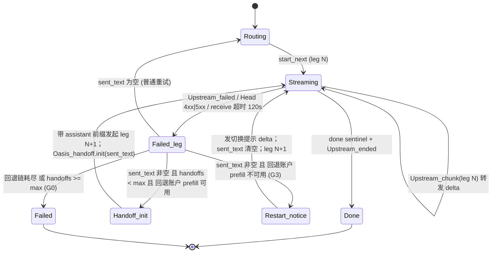

# Oasis — AI 账户 + Agent 门户

> 规格与初衷（Spec & Rationale）
> 版本 0.3 · 2026-11-03 · 与代码同源，随 `docs/ai-portal-plan.md` 战报演进
>
> 0.3 相对 0.2 的变化：把"无缝切换"从两行描述扩成带状态机、适用范围、降级行为与验收标准的
> 完整规格（§3）；修正评分算法里两处被写成"特性"的偏置（§2.3）；熔断区分瞬时故障与配额耗尽
> （§2.4）；新增安全边界（§5）与持久化语义（§6）；§1.4 选型论证改为只声明当下已兑现的部分；
> 末尾附 **0.3 实施清单（§8）**，每项带文件、行为与测试，可直接交给 agent 执行。
> 标记 **[0.3 新增]** 的条款为 0.3 引入的规格，**已全部实施**（状态与实施中的细化见 §8.0）；
> 未标记的条款描述 0.2 既有行为。

---

## 1. 初衷（为什么做这个）

### 1.1 起点：个人 AI 账户太多，用不过来

一个人同时拥有多个 AI 账户：DeepSeek、Kimi、GLM、OpenRouter、Claude Code、
ZCode…… 每个账户的**模型特点、余额、限额、速度**各不相同，而任务千差万别。
手工选择"这个任务该用哪个账户"既低效又容易出错——**quota 用完时任务中断、
费用花在错误的模型上、简单任务烧掉了旗舰模型**。

Oasis 要解决的四件事：

1. **懂模型**：每个账户/模型有什么强项（知识库 KB + tier + strengths）
2. **懂任务**：任务属于什么类别、要什么目标（最佳质量 / 均衡 / 最省 / 最快）
3. **懂成本**：每个账户的价格与预算（nano-dollar 记账，日/月限额）
4. **会调度**：综合以上 + 实时信号（时延/熔断/并发/余额错误），自动选最合适的账户

**最硬的要求**：任务执行中途 quota 耗尽（或账户故障），必须**实时切换到另一个
模型/账户继续完成，且用户端无感**——"无缝切换"是本项目的招牌能力。
0.3 对"无感"的准确定义见 §3.1：**客户端收到的文本流与单一账户一次完整生成等价；
切换对用户不可见，但对运维必须可见（事件流/决策记录中显式记录）。**

### 1.2 演进：从"账户门户"到"Agent 门户"

纯 API 账户没有工具（不能上网、不能写文件），很多任务天然做不了。而本机
有一批真正的 **agent**（Claude Code、Codex、opencode、gemini CLI……）——
它们有 terminal/files/web 能力。于是 Oasis 扩展为**双门户**：

- 纯对话/推理任务 → API 账户池
- 需要工具的任务（coding 等类别）→ **本地 agent 池**（子进程驱动，带看门狗与回退链）

调度原则：**provider 的主打模型优先；只放实测可用的模型；坏 agent 自动隔离**。

### 1.3 借鉴与差异化

| 项目 | 借鉴了什么 | Oasis 的差异化 |
|---|---|---|
| [AIUsage](https://github.com/sylearn/AIUsage) | 账户管理、CLI 代理、会话聚合、活动盘点 | 它是手动切换；Oasis 是**自动评分调度 + 无缝切换** |
| [Reason Machines](https://effect.grok.me) | MCP 入口、agent inbox（消息总线）、Cortex 风格过程可视化 | 它是云 agent + P2P 网络；Oasis 是**本地单机调度中枢**，中心化 inbox 更简单 |
| Riot / OCaml 底层 | Actor、结构化并发、单二进制 | 微秒级路由、单二进制、per-request 评分 |

### 1.4 底层选型：为什么 Riot/OCaml（当下已兑现 vs 待兑现）

**已兑现**（代码中可验证）：

- **单二进制**：一个 `oasis` 文件跑完整门户（HTTP/WS/MCP/dashboard），约 9.4MB
- **调度足够快**：`route_scored` 约 2µs（0.3 `riot bench`；0.2 记录为 33µs），可以每个请求都重新评分，不需要缓存决策
- **流式导体模式**：每个流式请求一个导体 actor，上游 I/O 跑在 `spawn_blocked` 阻塞道，
  通过 mailbox + `leg_id` 选择器把"旧 leg 的迟到消息"自然丢弃——这是无缝切换实现简洁的根本原因
- **跨请求共享状态**用 `ConcurrentHashMap` 承载（signals / task 句柄 / session 粘性），
  **不依赖** actor 间共享普通 map；因此熔断、并发计数在多个导体 actor 之间是生效的

**待兑现**（受 Riot 0.0.43 运行时限制，见 §4.2）：

- OTP 监督树接管 agent 子进程与导体 actor 的崩溃恢复。当前用 per-task blocking lane + 看门狗替代；
  崩溃隔离目前靠"一个请求一个 actor"的粒度，而非 supervisor 重启

0.2 把"Actor 崩溃隔离 / 监督树 / 结构化并发"写成选型理由，与 §4.2 的已知限制自相矛盾，0.3 改为如上表述。

---

## 2. 架构规格

### 2.1 分层

```
┌─────────────────────────────────────────────────────┐
│  客户端层: OpenAI 兼容 API · MCP 客户端 · Dashboard  │
├─────────────────────────────────────────────────────┤
│  Oasis 网关 (oasis_gateway.ml)                      │
│   ├─ HTTP 路由 (Trail)      ├─ MCP 端点 (/mcp)       │
│   ├─ 流式导体 (无缝切换)     ├─ WS 实时事件广播        │
│   ├─ 账户执行路径            ├─ Agent 执行路径        │
├─────────────────────────────────────────────────────┤
│  核心域模块 (oasis_*.ml)                             │
│   Router(评分) Signals(熔断) KB(fit) Ledger(记账)    │
│   Session(粘性) Handoff(去重拼接) Inbox(总线)        │
│   Agent(子进程) Anthropic(协议适配) Task(异步句柄)   │
│   Discover(盘点) Activity(聚合) Mcp(协议层)          │
├─────────────────────────────────────────────────────┤
│  自研底层: Atacama(TCP池) · Nomad(HTTP/WS)           │
│            Trail(管线/路由/SSE) · AegisOTP(监督树)   │
└─────────────────────────────────────────────────────┘
```

**结构债**（0.2）：`oasis_gateway.ml` 约 3200 行，占网关代码 43%，同时承载流式导体、账户执行、
agent 执行、HTTP 路由、WS 广播、MCP 分发和内嵌 dashboard HTML/JS。它是最难单测的模块。
**[0.3]** 已按 §7 拆分，`oasis_gateway.ml` 剩约 100 行；上图中的"网关"指拆分后的模块集合。

### 2.2 核心概念

| 概念 | 定义 |
|---|---|
| **Account** | 一个 API 账户：base_url / api_key_env / models / protocol（openai\|anthropic）/ thinking / rpm / 日限额 / 月预算 / **[0.3 新增]** `supports_prefill`（见 §3.2） |
| **Agent** | 一个本地 agent CLI：command / args 模板（`{prompt}` `{model}`）/ home / workdir / timeout_s / capabilities / tier |
| **Task profile** | 任务画像：category（general/coding/writing/analysis/translation/long_doc）× goal（best/balanced/cheapest/fastest）× model（可选强制） |
| **decision** | 每次调度的完整可解释记录：chosen / fallback_order / rejected（含原因）/ attempts（含状态、时延、错误）/ scores / **[0.3 新增]** handoffs（见 §3.4） |
| **signals** | 每账户/agent 实时信号：时延 EMA、熔断（错误率窗口 + 连续失败≥5 时间无关）、in_flight、日请求计数、**[0.3 新增]** `parked_until`（配额类错误的停牌时间，见 §2.4） |
| **handoff** | 无缝切换：新账户以"已发文本"为 assistant 前缀续写，前缀去重后只转发新增文本。完整规格见 §3 |

### 2.3 调度算法（route_scored）

```
候选 = 账户(或 agent) 满足硬约束：
       模型服务 / 熔断未开 / 未停牌 / 并发未满 / 月预算未超 / 日限额未达 / rpm 未达 / 上下文放得下
分数 = ( w_fit  × fit(tier × strengths/weaknesses, 0..100)
       + w_cost × cost_score(候选内相对归一化, 0..100)
       + w_lat  × latency_score(候选内相对：100 × 最快者EMA / 本账户EMA；无样本 = 50)
       + w_load × load_score(100 - in_flight×15, 底 0) ) / 100
权重 = 按 goal：best 60/10/20/10 · balanced 35/25/20/20 · cheapest 20/70/5/5 · fastest 10/10/70/10
选择 = 分数最高者（同分按配置顺序）；其余按分数排序为回退链，截断到 policy.max_fallback
```

硬约束之外还有**粘性会话**（`X-Oasis-Session` 头的多轮对话钉在同一账户）与
**显式模式**（`X-Oasis-Mode: agent|chat` 覆盖类别默认规则）。

**类别自动判定**（`Oasis_classify`）：请求未带 `X-Oasis-Category`（或值为 `auto`；MCP `oasis_ask`
未传 category 同理）时，按最后一条用户消息的关键词判定类别：含代码块 → coding；命中实时信息主题
（天气、新闻、股价、汇率、最新版本…）或检索动作（查一下、搜索、URL…）→ research；时间词（今天、后天、
最新…）+ 疑问且无代码迹象 → research；再依次 coding、writing，否则 general。判定结果与命中词随
`task_started`（`category_source: auto`、`category_hits`）下发，控制台路由说明以
「按内容判定为「联网检索」（命中：天气、后天）」开头。**推断出的类别不会自动切到 agent 模式**，
只有显式类别头或 `X-Oasis-Mode` 才会。

#### 2.3.1 当前实现的两处偏置（0.2 写成了"特性"，0.3 定义为缺陷）

1. **价格未知被当成最便宜**。模型不在 KB 中时 `price_nano = 0`，而 `cost_score` 按候选内
   min/max 归一化，于是未知价格拿满分 100；在 `cheapest`（w_cost = 70）下它几乎必胜。
   **[0.3 新增] 修正**：价格未知的候选不参与归一化区间计算，其 `cost_score` 固定为 50（中性），
   并在 decision.scores 旁记 `price_known=false`。
2. **当前 cheapest 实际不生效**。`oasis.toml` 中所有价格为 0，`max_price = min_price` 时全员
   `cost_score = 100`，cheapest 退化为 fit 20 / lat 5 / load 5。0.2 §3.4 "填上后成本调度才精确"
   应改为"填上前成本调度不生效"。**[0.3 新增]**：启动时若 goal 为 cheapest 且 KB 中已知价格的
   模型 < 2 个，日志打 WARN；`GET /api/accounts` 返回 `cost_routing_effective: false`。

#### 2.3.3 学习质量与探索

**质量**（`Oasis_quality`，按「执行者 × 类别」累积 0–100 分，持久化 `~/.oasis/data/quality.json`）：

- 来源一：控制台对成功任务点 👍（100）/ 👎（0），`POST /api/feed/rate {"id", "rating": 1|-1|0}`；
  改评价会先撤回旧的那次，0 = 撤销。
- 来源二：抽检评审（`Oasis_judge`，独立 actor，每 5s 扫一次任务流）：每 `policy.judge_every`（默认 10）个
  成功且有问题/回答文本的任务抽 1 个，交 `policy.judge`（`账户` 或 `账户:模型`，本机为
  `deepseek_pro:deepseek-flash`）打 1–5 分（映射 0/25/50/75/100），理由写进任务时间线。执行者是评审账户本身
  时跳过、顺延给下一个。留空 `judge` 即关闭。
- 合成：`fit = (配置适配分 × 5 + 评价分之和) / (5 + 评价次数)`——配置分相当于 5 次先验评价，评价越多越以实测为准。
  账户池与 agent 池都用。`parts` 带 `fit_static / rated / rating`，路由说明写"适配 X 由配置 Y 与 N 次评价（均 Z）合成"。
- 为此账户类任务的最终回答随 `task_done.answer` 进入任务流（原先只有 agent 任务有），问题原文随
  `task_started.prompt`（截 8000 字）。

**探索**：每 `policy.explore_every`（默认 10，0 关闭）次路由决策（账户池、agent 池、MCP 共用计数）有 1 次
把**测量次数 < 5** 的候选里次数最少者提为首选，常规首选退为第一备选（失败即回落）；所有候选都已测够 5 次时
不探索。`routed.explored = true`，路由说明标明"探索轮"。

#### 2.3.2 时延分的量纲问题

**[已修正]** 账户池时延分改为候选内相对分：`100 × 最快者 EMA / 本账户 EMA`（同速 100、慢一倍 50、
慢十倍 10）；EMA 为端到端耗时（流式按整段 leg），首个样本直接作为初值，**无样本时记中性 50**
（原先默认 800ms 让没用过的账户白拿 60 分、用过的全归零）。"空回答"的耗时也计入 EMA（不计错误）。
EMA 与样本数持久化到 `~/.oasis/data/latency.json`（每个 `task_done` 写一次，启动加载）。
`best` 权重由 70/10/10/10 调为 60/10/20/10：同速时强模型胜，慢几十倍时让位。
每个候选的四项分量（fit/cost/speed/load、EMA、样本数、权重）随 `routed` 事件的 `candidates[].parts`
与 decision 的 `scores[].parts` 下发，控制台路由说明写出算式。以下为历史记录：

`latency_score = 100 - EMA/20`：EMA ≥ 2000ms 即归零。API 账户首字节通常 200–1500ms，有区分度；
本地 agent 任务动辄 30–300s，**所有 agent 在 fastest 下时延分恒为 0**，fastest 对 agent 池无意义。
**[0.3 新增]**：agent 池使用 `latency_score_agent = 100 - EMA/2000`（每 2s 扣 1 分），
两套量纲在 `route_scored` 调用处由 pool 类型选择。

### 2.4 执行与容错

- **任务时长不由 Oasis 决定**：账户调用与 agent 都跑到完成为止，Oasis 不设总时限。只有两种方式提前结束——
  调用方用 `X-Oasis-Timeout: <秒>`（MCP 为 `timeout_s`）给出时限，或用户在控制台点「■ 停止」
  （`POST /api/feed/cancel {"id"}`）。两者都走同一条取消路径：杀掉 agent 进程树 / 放弃等待上游，
  **不换下一个候选、不扣执行者健康分**，任务状态为 `cancelled`，返回 499（流式以 `oasis_cancelled` 错误 + `[DONE]` 收尾）。
  仍保留的只有"连接已死"判定：流式上游 120s 没有任何字节视为断线（这是健康检查，不是时长限制）。
  委员会的每一席是例外，见下文「委员会」。
  agent 的 `timeout_s` 默认 0（不限）；配置了正数才会有看门狗。Oasis 自己的后台抽检（judge）单次 300s 上限
- **非流式**：按回退链逐个尝试（blocking lane），全程记账/信号/决策记录
- **流式（账户）**：导体 actor 管理当前 leg；上游断流/错误 → 触发 handoff（§3）。
  正常结束 = `data: [DONE]`，或收到非空 `finish_reason` 后上游关闭（Perplexity 不发 `[DONE]`）；
  两者都没有就关闭视为断流
- **空回答**：上游"正常结束"但没给客户端任何正文或工具调用（典型是推理模型把 `max_tokens` 全花在
  `reasoning_content` 上，`finish_reason: length`），流式与非流式都按失败处理并换下一个候选
  （`empty_answer_reasoning_exhausted` / `empty_answer`）；这类失败**不计入账户健康度**（不触发熔断）。
  推理模型的 `reasoning_content`（OpenRouter 为 `reasoning`）不进回答，按 ~240 字一批作为 `agent_step`
  的 `thinking` 步骤推到控制台时间线。`max_tokens` 只转发客户端给的值，Oasis 自己不设上限（控制台、CLI、MCP 都不再默认填）；
  Anthropic 协议必须带该字段，客户端没给时用 KB 中该模型的 `max_output`
- **流式（agent）**：子进程 stdout 逐行 → `Oasis_steps.parse` 把 claude / cursor-agent / gemini / kimi / grok
  的 JSON 事件流解析成工作步骤（`thinking` / `text` / `tool` / `tool_result` / `usage`），非 JSON 行与未知 CLI
  按纯文本处理。只有 `text` 进入客户端 delta（末尾 `result` 是全文重复，丢弃；整条消息之间、工具调用后续写的
  文字之间插空行）；思考与工具步骤**不进回答**，作为 `agent_step` 事件广播给控制台（§2.6）。
  心跳保活（10s 空 chunk）。标准输出和标准错误连续 120 秒没有任何字节时，视为进程已不再工作，杀掉进程树并记失败
  （grok 为 600 秒，它在两次输出之间会想比较久）。已经写出正文后再沉默，按已有回答收口，不记失败。这不是任务总时限：只要还在输出，就可以一直做下去。
  取消或（配置了 `timeout_s` 时）看门狗 SIGKILL：子进程由 perl 包装成为进程组组长，
  杀的是**整棵进程树**——先按 ppid 收集全部后代再杀，因为 grok 等 CLI 把工具命令放进各自独立的进程组，只杀组会留下仍在跑的工具进程
  （gemini 等 CLI 会 re-exec 出子 node 进程，只杀父进程会留下孤儿）。perl 包装在 agent 退出后**清理同组残留进程**
  再以 agent 的退出码退出——cursor-agent 会留下继承了 stdout 的后台 worker-server，不清理则管道永不 EOF，
  任务永远"进行中"。调用方中途断开时任务以失败结束（`task_done.error` 说明结果未送达）
- **异步任务**（MCP agent 任务默认）：秒回 task_id → `oasis_task_status` 轮询
  running/done/failed——解决"MCP 客户端超时 < agent 执行时长"的矛盾
- **指定 agent**（`X-Oasis-Agent: <name>`）：强制 agent 模式，只用这一个 agent——不探索、不替换，
  它不可用就直接失败（控制台：Agent 模式下类别选「自选」）
- **委员会**（`X-Oasis-Committee: a,b[,c]`，2–3 个账户或 agent，去重）：各成员并行做一次非流式调用。
  每一席有时限：请求头 `X-Oasis-Timeout`，否则 180 秒。到点只取消这一席（agent 会杀掉进程树），时间线记失败，
  已经回来的回答照常汇总；停止按钮仍取消整场。每家答完即推 `committee_member` 事件；≥2 家成功后按 `analysis`
  类别 + 请求的 goal 由路由器挑汇总模型（可以是成员之一，失败按回退链换下一个，汇总本身也受同一时限，
  超时则直接给出各家原文），回答 = `## 汇总（X）` + 汇总 + 各家原文；只有 1 家成功则直接返回原文，
  全失败 502。`oasis` 字段列出成员成败与汇总者（控制台：问答模式下类别选「委员会」，多选成员）

#### 2.4.1 失败分类与熔断 **[0.3 新增]**

0.2 把所有失败一视同仁：连续 5 次 → 熔断 30s → 半开探测。这对 5xx/超时合理，
对"今天没钱了"（z.ai 429 code 1113、OpenAI `insufficient_quota`、Anthropic `rate_limit_error` 带
daily 语义）是**每 30s 烧一次请求并污染时延 EMA**。0.3 区分三类：

| 类别 | 识别规则 | 处理 |
|---|---|---|
| **transient**（瞬时） | 5xx、连接失败、读超时、流中断且无配额特征 | 现有熔断：窗口错误率或连续 5 次 → Open 30s → Half_open 单探测 |
| **quota**（配额/余额） | HTTP 402；HTTP 429 或 403 且 body 含 `1113` / `insufficient_quota` / `balance` / `credit` / `quota` / `余额`；provider 自定义码表（配置 `quota_error_codes`） | `parked_until` = 下一 UTC 日 00:00（日配额）或下月 1 日（月预算，由配置 `quota_reset` 决定，默认日）；停牌期间视为硬约束不通过，reject 原因 `quota_parked`；不计入时延 EMA；并清掉此前的 `auth_invalid` |
| **client**（请求本身错） | 4xx 非 429/402（400 参数错、401 密钥错、403 且正文看不出额度、413 过长） | 不触发熔断；401 与这种 403 额外写 `auth_invalid` 信号并在 `/api/accounts` 显示；不进入回退链（换账户也会失败的错误除外：413 可回退到更大 context 的账户） |

识别函数 `Oasis_signals.classify_error : status:int option -> body:string -> error_class` 为纯函数、可单测。

### 2.5 对外接口

| 接口 | 说明 |
|---|---|
| `POST /v1/chat/completions` | OpenAI 兼容（流式 SSE / 非流式）；头 `X-Oasis-Category` `X-Oasis-Goal` `X-Oasis-Mode` `X-Oasis-Session`；可选 `X-Oasis-Source`（来源标签，默认 `api`）、`X-Oasis-Client-Ref`（原样回显在 `task_started`，供控制台关联自己发起的请求）、`X-Oasis-Agent`（指定 agent）、`X-Oasis-Committee`（委员会成员，§2.4）、`X-Oasis-Thread`（续接对话，§2.6.2；响应头回传本轮所属的对话 id） |
| `GET /v1/models` | KB 模型列表 |
| `POST /mcp` | MCP（JSON-RPC 2.0 / Streamable HTTP 简化）11 工具：oasis_ask、oasis_agent_task、oasis_task_status、oasis_status、oasis_decisions、oasis_send_message、oasis_check_inbox、oasis_ask_user、oasis_activity、oasis_agents、oasis_models |
| `GET /api/*` | accounts（状态）、decisions（决策）、ledger（账本）、reload（热重载）、inbox（未读）、agents（盘点 + 已配置 agent 的信号）、activity（本机 Claude、Cursor、Codex、DeepSeek Harness、ZCode、WorkBuddy、Grok 的会话，加上 Oasis 自己派出的任务）、requests（审计）、**feed**（最近任务摘要）、**feed/task?id=**（单任务：路由说明 + 时间线 + 回答）、**threads?limit=**（最近对话摘要）、**thread?id=**（整段对话：各轮问答 + agent 会话 id；不存在 404）、**workspace?id=**（任务工作目录里的文件列表）、**workspace/file?id=&path=**（读一个产出文件，文本最多 512 KB）；`POST /api/thread/delete {"id"|"task", "files"}`（删除对话或无对话的任务，§2.6.5）、**alerts**（需要处理的问题 + 可复制的修复命令）；配置向导（§2.8）：`GET /api/setup/scan`、`POST /api/setup/verify`、`POST /api/setup/apply` |
| `WS /ws` | 实时推送：decision + 事件流（task_started → routed → attempt_started → attempt_finished → **[0.3 新增]** handoff → task_done，以及 agent 的 `agent_step`） |
| `GET /` | 控制台（§2.6）：工作台（任务列表 / 任务详情 / 需要你处理 + 资源）与诊断页（账户明细、原始决策、过程图、agent 盘点、会话活动、收件箱） |

**[0.3 新增]** 所有非 `GET /` 与非静态资源的接口受 §5 的鉴权约束。

### 2.6 控制台与任务流

工作台任务列表同时列出本机 agent 自己正在做的会话（Claude、Cursor、Codex、DeepSeek Harness、ZCode、WorkBuddy、Grok）。点开可以看项目目录和最近正文；在下方继续会指定对应 agent、原来的目录，并用 `X-Oasis-Resume` 续接那个会话。Oasis 不向这些进程发停止信号。

`Oasis_feed` 在 `broadcast_event` 处把每个事件折叠进按 `request_id` 的任务记录（内存，保留最近 200 条，
重启清空）：标题（最后一条 user 消息，折叠空白）、来源（api / mcp / dashboard）、执行者、状态、时间线、
agent 回答文字。路由说明与切换说明在服务端生成人话（"交给 agent X：编程任务里适配分最高（200）；备选…；
排除 Y（熔断中）"；handoff 按 G1/G2/G3 说明是无缝续写、去重续写还是重新生成），错误串翻译成可行动的
原因（认证失败 / 被限流 / 连接或 DNS 问题 / 进程异常退出…），原文保留在旁边。

- 账户路径、chat-agent 路径（同步与流式）和 MCP agent 任务（同步与异步）**都**发完整事件链；
  任何提前返回（无候选、tools 无兼容账户、调用方断开）都发 `task_done`，任务不会停在"进行中"
- `agent_step` = `{agent, step}`，step 字符串字段经 `redact_secrets`；token 级增量（`delta`）在任务流里并入
  同 agent 同类的上一步
- `/api/alerts` 来源：启用账户缺环境变量 key、`auth_invalid`、配额停牌、熔断；启用 agent 的 CLI 未安装 /
  未登录、连续失败。每条带 `fix`（如 `export KEY=…`、`cursor-agent login`、`dig +short host @1.1.1.1`）
- 问答类请求的回答正文**不进**任务流（只回给调用方；控制台自己发起的请求在浏览器本地显示）；
  agent 的说明文字作为步骤进入任务流
- 控制台不是聊天布局：输入栏 + 三栏（任务列表 / 详情：路由说明、执行过程时间线、输出 / 需要你处理 + 资源），
  右栏可收起（顶栏「侧栏」按钮或 `\`，状态存 localStorage），收起后详情栏占满剩余宽度；
  键盘 `/` 输入、`⌘↵` 运行、`j` `k` 切换任务、`1` `2` `3` 切换详情页签（执行过程 / 输出 / 对话）、`g` 收起或展开路由说明（状态存 localStorage）、`4` 产出文件、`r` 聚焦续接输入框、`\` 切换右栏

#### 2.6.2 连续对话（thread）

每个请求都属于一个对话（`Oasis_thread`）：没带 `X-Oasis-Thread` 时新建（`th-…`），带了就作为下一轮追加。
`task_done` 时把本轮（问题、回答前 20000 字、执行者、模式、状态）写入对话并落盘 `data_dir/threads.json`
（保留最近 300 个，重启后仍可续接）。

- **上下文**：账户路径把历史轮次按 user/assistant 插到 system 消息之后（最多约 60000 字，保留最新的轮次；
  未完成的轮次标注「上一轮未完成」）；调用方自己已带 assistant 历史时不再插入
- **继承**：续接轮没有显式指定 mode / agent / category 时沿用上一轮：agent 轮继续交给同一个 agent
  （路由优先它，`routed` 带 `continued`，人话写「延续上一轮的 agent」）；委员会轮沿用同一组成员；
  问答轮优先上一轮的账户，失败时照常回退。显式指定的头总是优先
- **agent 会话续接**：agent 输出里的会话 id（`session_id` / `sessionId`，取最后一个）通过 `agent_session`
  事件记入对话。续接时用 `resume_args` 让 CLI 接着自己的会话，只把新的一句话作为 prompt；
  默认 claude / cursor-agent / gemini / grok 为 `["--resume", "{session}"]`，kimi 为 `["--session", "{session}"]`，
  可在 `[[agents]]` 里用 `resume_args` 覆盖。换了 agent 或没有会话 id 时退回到「历史文本 + 新问题」
- **控制台**：任务列表按对话分组（一行一个对话，显示轮数；只在 `threads.json` 里的旧对话标「历史」），
  详情里有轮次切换、「对话 · n 轮」页签和底部续接输入框（显示这一轮会交给谁、是否续接 CLI 会话）；
  上一轮还在执行时不能续接
- 限制：MCP 工具暂不支持 thread；任务流的执行过程不落盘，历史对话只能看问答

#### 2.6.3 任务工作目录（workspace）

没有配置 `workdir` 的 agent 不在网关目录里执行，而在任务自己的目录 `<workspace_dir>/<id>` 里执行
（默认 `~/.oasis/workspaces`；显式设了 `data_dir` 而没设 `workspace_dir` 时为 `<data_dir>/workspaces`）：对话里的 agent 轮用对话 id，同一对话的每一轮共用一个目录，
续接时 agent 能接着改上一轮的文件；MCP 的 agent 任务用 request id。

- 配置了 `workdir` 的 agent、MCP 调用显式给了 `workdir` 的，照旧用指定目录
- 有工作目录之前就已经产生 CLI 会话的对话，继续在原来的目录执行（CLI 会话按目录保存，换目录就续不上）
- 相对路径的 agent `command`（含 `/`）在切目录前按网关目录转成绝对路径；不含 `/` 的照旧走 PATH
- `workspace` 事件 `{id, dir}` 记入任务流（`workspace` / `workdir` 字段）和对话（`workspace`）
- `/api/workspace*` 只接受 Oasis 自己生成的 id（字母数字 `-` `_`），路径不能是绝对路径或含 `..`，
  解析后的真实路径必须仍在该目录内（指向外面的符号链接拒绝）；列表跳过 `.git` `node_modules` 等，最多 500 个文件
- 控制台：详情头部 📁 标签点一下复制目录路径；「产出 · n」页签列出文件（大小、修改时间），点文件看内容；
  任务完成时自动刷新；快捷键 `4`
- 限制：agent 仍可以按绝对路径写到别处，目录只是默认位置，不是沙箱

#### 2.6.5 网关重启与删除

- agent 的进程组组长（perl）每 0.2s 检查父进程；网关一消失（重启、崩溃、kill -9）就杀掉 agent 整棵进程树，
  不留无人看管的 agent
- 轮次在 `task_started` 时就以 `running` 写进对话，`attempt_started` 记下执行者；网关启动时把仍是 `running`
  的轮次标成 `interrupted`（控制台「已中断」）。续接照常交回同一个 agent 并续接它的 CLI 会话；
  中断前的部分输出不落盘，历史里标「上一轮未完成」
- 删除：`POST /api/thread/delete`，`id` 为对话 id（或 `task` 为无对话任务的 request id），`files: true` 时
  连工作目录一起删（只删工作目录根下的直接子目录）。正在运行的轮次先停掉；从任务流和 `threads.json`
  中移除，广播 `thread_deleted`，其他打开的控制台同步移除。控制台详情头部「删除」按钮，二次确认是否删产出文件

#### 2.6.4 无人值守的提问

agent 在无头模式下运行，交互式提问工具没人能答（claude 的 AskUserQuestion 会直接失败并卡住任务）。
新任务的 prompt 前面加一段 `[Oasis]` 说明：能选合理默认就直接选并说明；必须由用户决定的，把问题和选项写在
回答末尾、结束本轮，用户在续接框里回答（§2.6.2，同一会话、同一目录接着做）。`oasis.toml` 里 claude 另加
`--disallowedTools=AskUserQuestion`（必须用 `=` 写法：这个选项接多个值，分开写会把后面的 prompt 吞掉）。

#### 2.6.1 诊断页过程图

事件驱动的 SVG 过程图（rank 分层、S 曲线边、回退回环、发光节点，零外部依赖）。
视觉细节（曲线偏移像素、渐变色值等）从 spec 移出，归入 `docs/ai-portal-plan.md` §16.25。
spec 只约束**语义**：

- 五类事件各有独立节点状态：候选（灰蓝）/ 执行中（青色脉动）/ 成功（绿）/ 失败（红）/ 被拒（灰红）
- **[0.3 新增]** `handoff` 事件在图上表现为"失败节点 → 新尝试节点"的回环边，并在节点上标注
  `prefix_matched` 字节数与 `diverged` 状态，使 handoff 质量可视
- **[0.3 新增]** 账户路径（同步与流式）与 agent 路径发出同一组事件：
  `task_started → routed → (attempt_started → attempt_finished)+ → task_done`，`handoff` 在新 leg 的
  `attempt_started` 之后、级别判定完成时发出；事件带 `request_id`，过程图只跟随最近一个 `task_started` 的请求（并发请求的事件交织在同一 socket 上）

### 2.7 配置（oasis.toml）

```toml
[server]          # host / port / data_dir（默认 ~/.oasis/data）/ [0.3] auth_token_env / workspace_dir（默认 ~/.oasis/workspaces）
                  # 路径支持 ~/ 写法；配置文件默认 $OASIS_HOME/oasis.toml（即 ~/.oasis/oasis.toml），首次运行自动生成
[[models]]        # KB：name/tier/strengths/weaknesses/context/max_output/latency/价格(nano)
[[accounts]]      # 见 2.2；protocol="anthropic" 走适配器；thinking="disabled" 关思考
                  # [0.3] supports_prefill = true|false（默认 anthropic=true, openai=false）
                  # [0.3] quota_error_codes = ["1113"]（可选，provider 自定义配额错误码）
                  # [0.3] quota_reset = "daily"|"monthly"（停牌到次日 / 次月 1 日，默认 daily）
                  # [0.3] stream_usage = true（流式请求附 stream_options.include_usage）
                  # connect_ip = "1.2.3.4"（可选，TCP 连接改连此 IP 绕过 DNS 污染；SNI/Host 仍用 base_url 域名）
[[agents]]        # 见 2.2；enabled=false 的 agent 不进候选池
                  # resume_args = ["--resume", "{session}"]（续接 CLI 会话，见 §2.6.2）
                  # [0.3] allowed_workdirs = ["/home/u/proj"] / env_passthrough = ["GH_TOKEN"]（见 §5）
[[routes]]        # category -> 账户链
[policy]          # goal / agent_categories（自动走 agent 池的类别）/ max_fallback
                  # [0.3] max_handoffs = 2 / handoff_notice = true / session_ttl_s = 600
```

密钥只通过环境变量注入（`api_key_env`），**永不落盘到配置**。在配置页粘贴的 key 存进
`$OASIS_HOME/secrets.env`（`KEY=value` 行，权限 0600，先写临时文件再原子改名），启动时加载进进程环境；
同名时文件里的值优先于 shell 里的值。

### 2.8 配置向导

目标：用户只需点选就能用起来，不必手写 TOML。实现在 `Oasis_setup`（目录、探测、实测、文本合并）、
`Oasis_setup_api`（三个接口）、`Oasis_setup_ui`（嵌入控制台的中英双语浮层）。

- **内置目录**：13 家服务商，每家给出端点列表（如 Kimi：Kimi Coding → moonshot.cn → moonshot.ai；
  GLM：z.ai Anthropic 端点 → z.ai paas → bigmodel）、协议、标准 key 变量名、已知模型及其 KB、
  `prefer` 顺序和申请 key 的链接；6 个 agent 的无人值守参数（Claude Code 禁用 `AskUserQuestion`）。
  目录外的模型按名字推断 KB（按名称分词判断 mini/flash/lite 等，避免 "gemini" 误判为 mini；
  `gemini-3.1-pro-preview` 这类变体沿用最长前缀的目录项）
- **探测**：key 变量取标准名，再加上任何同时含服务商关键字和 key/apikey/token/secret 片段的变量
  （按 `_` 分词、不区分大小写）；agent 在 PATH 和常见安装目录（~/.local/bin、/opt/homebrew/bin 等）里找，
  写入绝对路径；Ollama 读 `/api/tags`，云端模型逐个试问一次，嵌入模型剔除
- **实测**：每个候选依次试各端点：`GET /models`，再用一个模型发 16 token 的 "ping"。
  状态从好到差：`ok`、`rate_limited`、`no_balance`、`model_error`、`invalid_key`、`unreachable`、`no_key`，
  保留最好的端点。实测都在 blocking lane 里并行跑，有总超时
- **首次启动**：配置文件不存在时，并行实测全部候选（40 s 超时），`no_balance` 及更好的账户写入配置，
  再加上 Ollama（`ollama_cloud` / `ollama_local`）和所有已安装的 agent；生成 general / research 路由；
  写 `.setup-pending` 标记，控制台据此自动弹出配置页确认
- **`needs_setup`**：有 `.setup-pending` 标记，或者既没有可用账户也没有已安装且启用的 agent
- **合并（apply）**：在原文本上按块编辑，不重新序列化。只改用户勾选变化的 `enabled` 行；新的模型、
  账户、agent 追加在 "added by the Oasis setup wizard" 注释之后；新账户按类别追加进已有的 `[[routes]]`；
  没有任何路由时才生成路由；可选改 `policy.goal`。多行数组按方括号配平识别。
  没选任何改动时输出与输入逐字节相同。写入前先用 `Oasis_config.load` 校验合并结果，旧文件留作
  `oasis.toml.bak`，然后热替换运行中的配置并删除 pending 标记

---

## 3. 无缝切换（handoff）规格 **[0.3 新增章节]**

### 3.1 目标与保证

**目标**：流式请求执行中上游死亡（断流 / 429 / 5xx）时，客户端收到的最终文本与
"某一个账户一次完整生成"在语义上等价，且**不出现重复段落、不出现截断的多字节字符、
SSE 帧格式始终合法**。

**保证分级**（spec 只承诺能验证的）：

| 级别 | 条件 | 保证 |
|---|---|---|
| **G1 精确续写** | 回退账户支持 assistant prefill 且逐字节复述或直接续写 | 客户端零重复、零丢失 |
| **G2 近似续写** | 回退账户支持 prefill，但复述时改写了前缀（标点/空格/同义） | 从分叉点起转发；客户端可能看到 ≤ 一个句子的重叠。decision 记 `diverged=true, matched_bytes=N` |
| **G3 重新作答** | 回退账户不支持 prefill，或分叉发生在前缀 < 20% 处 | 不拼接。关闭当前流前先发 `[Oasis: 上游中断，已切换到 <account> 重新生成]` 的 delta（可配置关闭），再以空 sent_text 重新开始。用户可见但不丢任务 |
| **G0 失败** | 回退链耗尽或 handoff 次数达上限 | `finish_failed`：发送 SSE error 事件 + `[DONE]`；decision 状态 failed |

0.2 的"客户端零重复"只在 G1 成立。0.3 要求 decision 记录实际达到的级别。

### 3.2 适用范围

handoff 仅在**全部满足**时启用，否则按 G3 处理（重新作答）或直接 G0：

- 请求无 `tools` / `tool_choice` / `response_format: json_*`（前缀续写对结构化输出不成立）
- 当前已发送文本 `sent_text` 非空（为空时直接换账户重试，不是 handoff）
- 回退账户 `supports_prefill = true`（默认：`protocol="anthropic"` 为 true；openai 协议默认 false，
  DeepSeek 需显式 `supports_prefill = true` 并由适配器附加 `prefix: true` beta 字段）
- 已切换次数 < `policy.max_handoffs`（默认 2，与当前代码一致）

**模型选择**：回退 leg 使用回退账户服务的、**与原请求 task.model 相同的模型**；若该账户不服务
该模型，用其首个模型（当前行为），并在 decision 记 `model_changed=true`。

**thinking 模型**：handoff 时对回退账户强制 `thinking="disabled"`（思考模型通常拒绝 prefill 或
会在前缀前输出思考块）。

### 3.3 导体状态机



旧 leg 的迟到消息由 `leg_id` 选择器丢弃；`receive` 超时 120s 视为 `Upstream_failed`。

### 3.4 去重器（Oasis_handoff）规格

当前实现是逐字节匹配：匹配中累加 `match_pos`，第一个不匹配字节起 `diverged=true` 全量转发。
0.3 补三条：

1. **UTF-8 边界安全**：`feed` 转发的字节串必须在 UTF-8 字符边界切分。分叉发生在多字节字符中间时，
   回退到该字符起始字节再转发（即转发完整字符，而不是尾部若干字节）。同样，每次 `feed` 若 chunk
   末尾是不完整的多字节序列，暂存到下次 `feed`，不单独发出
2. **分叉位置阈值**：`diverged` 发生在 `0 < match_pos < 0.2 × sent_len` 时，视为回退模型"重新作答"
   （G3），返回信号 `Restart` 让导体走 Restart_notice 路径，而不是把一整段近似重复文本转发给客户端。
   `match_pos == 0`（首字节即分叉）需进一步区分"直接续写"与"重新作答"，规则见 §3.6 H2 注
3. **状态外露**：`t` 新增 `matched_bytes` / `diverged_at` 只读访问器，供 decision 记录

decision 新增字段：

```json
"handoffs": [
  { "from": "deepseek", "to": "kimi", "reason": "stream_failed",
    "sent_bytes": 1832, "matched_bytes": 1832, "diverged": false,
    "level": "G1", "model_changed": false, "at_ms": 1730000000000 }
]
```

WS 事件流新增 `handoff` 事件，payload 同上一条。

### 3.5 与粘性会话的交互

`X-Oasis-Session` 钉住的账户在流中失败时：

- 本次请求按 §3.3 切换；**切换成功后 pin 迁移到新账户**（当前代码已在 handoff 成功时重新 pin，
  0.3 明确为规格）
- 若失败类别为 quota（§2.4.1），pin 迁移且原账户进入停牌，后续轮次不会再回到它
- 若为 transient，pin 迁移；原账户熔断恢复后**不**自动迁回（避免同一会话在两个模型间来回跳）

### 3.6 验收测试（基于 Oasis_mock，必须全部通过）

`oasis_mock` 已支持 `cut_after_bytes` 断流与 429 场景。0.3 要求以下用例进入 `oasis_tests.ml`：

| 用例 | 场景 | 断言 |
|---|---|---|
| H1 精确续写 | mock_a 在 N 字节断流；mock_b 复述前缀后续写 | 客户端拼接文本 == mock_b 完整文本；decision.handoffs[0].level == G1 |
| H2 直接续写 | mock_b 不复述前缀直接输出新文本 | 客户端文本 == 前缀 + 新文本；`classify` 判为直接续写 → level G1；matched_bytes == 0（见注：首字节即分叉但不是重新作答） |
| H3 多字节边界 | 断流点与分叉点都落在一个 3 字节汉字中间 | 客户端每个 SSE delta 的 content 都是合法 UTF-8；拼接文本无 U+FFFD |
| H4 近似续写 | mock_b 复述时把前缀某处标点改掉 | level G2；客户端文本重叠 ≤ 分叉点到前缀末尾长度 |
| H5 重新作答 | mock_b 第 3 字节即分叉且后续与前缀无公共前缀 | 走 Restart_notice；客户端收到提示 delta 后文本重新开始；level G3 |
| H6 上限 | mock_a、mock_b、mock_c 连续断流 | 第 3 次不再 handoff；SSE error + [DONE]；decision failed；handoffs.length == 2 |
| H7 不适用 | 请求带 `tools` | 断流后不走 handoff，直接 G3 或 G0；handoffs 为空 |
| H8 pin 迁移 | 带 X-Oasis-Session，mock_a 断流切到 mock_b | 第二轮请求直接路由到 mock_b |

注（H2）：区分"直接续写"与"重新作答"需要启发式：直接续写时回退输出的前若干字节与
`sent_text` **末尾**衔接自然（无法纯文本判定），而重新作答通常以与 `sent_text` **开头**相似但不等的
文本开始。0.3 的规则：分叉在 `match_pos == 0` 且回退输出前 32 字节与 `sent_text` 前 32 字节的
编辑距离 > 16 → 直接续写（G1）；否则 → 重新作答（G3）。该启发式作为 `Oasis_handoff.classify`
纯函数实现并单测。

---

## 4. 已知限制（诚实清单）

### 4.1 环境类

1. **本机 agent CLI 可用性**是环境问题：claude 需登录且 `-p` 需 `--verbose`
   + `--dangerously-skip-permissions`；opencode/gemini 在本机有自身 bug/网络问题
   （已通过 `enabled=false` 隔离，修好即可用）
2. **riot 工具链缓存坑**：lib 改动后 `riot test`/`riot run` 可能跑旧产物，
   **改 lib 后必须 `riot clean --force` 重建**；启动网关用
   `_build/.../out/oasis/oasis` 正规产物
3. GLM 账户余额不足（z.ai 429/1113）时由停牌机制（§2.4.1）隔离；ZCode 的 bigmodel 登录态
   不落盘，无法直接复用（z.ai anthropic 端点是可用路径）

### 4.2 运行时类

4. **Riot 0.0.43 运行时限制**（`docs/ai-portal-plan.md` §16.20 有完整证据链）：测试 actor 里 spawn
   挂起、跨 actor 共享普通 map 不可见、`Supervisor.Dynamic.start_child` 挂起——因此
   agent 执行采用 per-task blocking-lane + 看门狗。挂起与段错误的根因已由下述补丁修复，
   OTP 监督树集成本身仍未做（§9）。
   跨请求共享状态统一走 `ConcurrentHashMap`（§1.4）

   **[0.3 新增]** 上面的"spawn 挂起 / start_child 挂起 / 测试中 SIGSEGV"已定位为 Riot 0.0.43
   kernel/std 的四个缺陷，以补丁形式放在 `patches/riot/`，由 `scripts/patch-riot.sh` 幂等打到
   `~/.riot/registry/pkgs.ml/src/<pkg>/<ver>`（Riot 没有依赖覆盖机制；`riot plan` 拉源码后、
   `riot build` 前执行，CI 同此流程）：

   | 补丁 | 缺陷 | 现象 |
   |---|---|---|
   | kernel `generational-root` | `kernel_new_linux_update_token`（及 macOS 分支）在 `caml_modify_generational_global_root` 前先直接写 root，GC 看不到 old→young 迁移，`caml_global_roots_old` 留下悬垂指针 | 并行测试 `caml_darken` 段错误（`--large` 下 100% 复现） |
   | std `lost-wakeups` ① | receive 超时在进程仍为 `Running` 时触发，`wake_process` 空操作；`park_for_receive` 之后只复查 mailbox、不复查超时标记 | `sleep`（= 带超时、全部 Skip 的 receive）永久挂起；Atacama `start_link` 末尾的 `sleep 5ms` 即命中点 |
   | 同上 ② | `install_{receive,syscall}_timeout` 先加定时器、后记录 id；其间到期的定时器因 id 不匹配被丢弃 | 同上；syscall 版表现为忙等 |
   | 同上 ③ | `step_process` 中 `has_messages && try_mark_runnable…`：`Kernel.(&&)` 是普通函数、不短路，无消息时也把 `Waiting_message` 翻成 `Runnable` 却不入队 | 进程停在 `Runnable` 但不在任何队列 |
   | 同上 ④ | 定时器轮 `tick` 把 `current_time` 直接设为 `now`，丢弃不足一格的余量；`calculate_slot` 可能把定时器放进已处理的当前格 | reactor 循环快于一格时轮子冻结；短定时器晚一整圈触发 |

   修复后 `riot test`（默认并行）连续 3 次 86/86，`oasis_tests --concurrency 4/8/16` 共 60 次 0 挂起
   （修复前 4 并发约 15–30% 挂起）。补丁应同步上游；升级 Riot 版本时须重新核对

### 4.3 数据类

5. **价格字段目前全部为 0**——成本调度当前**不生效**（§2.3.1），填上后才生效；
   少于两个有价模型时启动打 WARN，`/api/accounts.cost_routing_effective = false`
6. 输出 token 计数为 `bytes / 4` 估算，中文场景偏差可达 2–3 倍；记账以上游返回的 `usage` 为准，
   仅在上游未返回时用估算（**[0.3 新增]** 流式请求附 `stream_options.include_usage`，读末尾 usage
   chunk；Anthropic 读 `message_start`/`message_delta`；账户可用 `stream_usage = false` 关闭）
7. **tools 仅对 OpenAI 协议账户透传** **[0.3 修订]**：`tools`、`tool_choice`、`parallel_tool_calls`、
   `functions`、`function_call`、`response_format` 以及 `temperature`/`top_p`/`stop`/`seed`/
   `presence_penalty`/`frequency_penalty`/`user` 原样转发给 `protocol = "openai"` 的上游（`n` 不转发：
   导体只中继一个 choice）。非流式响应原样返回，`tool_calls` 不受影响；流式导体把携带
   `tool_calls`/`function_call` delta 或 `finish_reason = "tool_calls"` 的事件**逐字中继**。
   限制：
   - Anthropic 协议没有工具/结构化输出的格式转换：带上述前五个字段之一的请求只在 OpenAI 协议账户间
     路由；可路由账户全为 Anthropic 时返回 `400 tools_require_openai_protocol_account`
   - 工具调用 delta 一旦发出，该 leg 断流即以 SSE 错误结束（G0），不重启、不拼接——半截参数无法修复；
     此前只发出过文本时仍按 §3.2 走 G3

---

## 5. 安全边界 **[0.3 新增章节]**

Oasis 是一个能 spawn `claude --dangerously-skip-permissions` 的 HTTP 服务。
**任何能访问其端口的进程等价于拿到本机 shell**。0.2 只写了"密钥不落盘"，不够。

### 5.1 网络面

- `server.host` 默认 `127.0.0.1`（当前已是）；配置为非回环地址且 `auth_token_env` 未设置（或其环境变量为空）时
  **拒绝启动**
- **[0.3 新增]** `server.auth_token_env`：设置后，`/v1/*`、`/mcp`、`/api/*`（`reload` 在内）、`/ws`
  必须带 `Authorization: Bearer <token>` 或 `?token=`（仅 WS）；`GET /` dashboard 页面本身不鉴权，
  但其 JS 从 `localStorage` 读 token 附到请求头。未设置时仅允许回环地址连接（拒绝非回环 peer）
- `/api/reload` 只接受 `POST`；`GET /api/reload` 返回 405
- 未设置 token 时，带 `Origin` 头的请求要求 Origin 主机为回环地址（`localhost` / `127.*` / `::1`），
  否则 403。原因：响应带 `Access-Control-Allow-Origin: *`，不加此检查任何网页都能经浏览器驱动本机 agent
  （CSRF / DNS rebinding）
- token 比较为常量时间；token 每次请求从环境变量读取（轮换无需重启）；CLI 从 `OASIS_AUTH_TOKEN` 读取；
  dashboard 支持 `/?token=…` 一次性写入 `localStorage`

### 5.2 Agent 执行面

- **[0.3 新增]** `agents[].allowed_workdirs`：请求指定 workdir 时必须是列表内路径或其子目录
  （规范化后前缀匹配，拒绝 `..`）；未配置时只允许 agent 默认 `workdir`
- `oasis_agent_task` 的 prompt 在写入子进程 argv 前**不做模板展开以外的任何处理**；
  `{prompt}` 作为单个 argv 元素传入，不经 shell
- agent 子进程继承的环境变量白名单：`HOME`（agent.home，未配置时继承）、`PATH`、`LANG`、`LC_ALL`、
  `TERM`、`USER`、`LOGNAME`、`SHELL`、`TMPDIR`，加上 `agents[].env_passthrough` 列出的变量；
  **不继承** Oasis 自身的 `*_API_KEY`。实现为 `env -i K=V… <command> <args…>`
  （Riot 的 `Process.spawn ~env` 是合并而非替换父进程环境）
- `oasis_agent_task` 的 `workdir` 参数按 `allowed_workdirs` 校验后作为子进程 cwd

### 5.3 消息总线（inbox）注入面

`oasis_send_message` → agent `oasis_check_inbox` → agent 执行其中内容，是一条 prompt injection 路径。
**[0.3 新增]**：

- inbox 条目带 `from` 字段，agent 读取时 Oasis 在每条前注入 `[来自 <from>，未经验证的消息]` 前缀
- `oasis_send_message` 受 §5.1 鉴权约束（同一 token 下视为可信来源，但仍带前缀）
- inbox 条目长度上限 16KB，超出按 UTF-8 字符边界截断并标记 `truncated=true`，读取时附截断提示
- 收件人名即文件名：必须匹配 `[A-Za-z0-9_.-]{1,64}` 且不以 `.` 开头（否则 `to = "../x"` 可写出 inbox 目录）

### 5.4 日志与审计

- `/api/requests` 审计记录**不含**消息正文：`ts/path/category/goal/stream/request_id/body_len/body_hash8`
  （FNV-1a 32 位）。账户与状态在 decision 里，用 `request_id` 关联
- 进入 decision、signals.last_error、dashboard 的错误文本统一经 `Oasis_signals.redact_secrets`：
  `Bearer <token>` → `Bearer ****`，`sk-` 开头且 ≥ 8 字符的串 → `sk-****`

---

## 6. 持久化语义 **[0.3 新增章节]**

| 数据 | 位置 | 方式 | 跨重启 | 说明 |
|---|---|---|---|---|
| ledger（账本） | `<data_dir>/ledger.jsonl` | 快照重写 | 保留 | 月预算/日限额依赖它；重启不清零 |
| inbox | `<data_dir>/inbox/<agent>.jsonl` | 追加 | 保留 | 已读标记仅内存；**[0.3 新增]** 重启后按 `read_at` 字段恢复 |
| signals（EMA/熔断/in_flight） | 内存 `ConcurrentHashMap` | — | 丢失 | 重启后熔断清零是**预期行为**；**[0.3 新增]** `parked_until` 例外，持久化到 `<data_dir>/parked.json`，否则重启会让已没钱的账户重新进池 |
| session pin | 内存 | — | 丢失 | TTL 由 `policy.session_ttl_s` 控制 |
| decisions | 内存环形缓冲（200）+ `<data_dir>/decisions.jsonl` | 追加 | 保留 | **[0.3 新增]** 保留最近 1000 条（启动时及每 1000 次追加压缩一次）；`/api/decisions?limit=` 返回本次运行的决策 + 历史 |
| task 句柄 | 内存 | — | 丢失 | 重启后 `oasis_task_status` 对旧 task_id 返回 `unknown`，不返回 failed |

**decision schema 版本**：每条 decision 带 `"schema": 2`（0.2 为隐式 1）；新增字段只增不改，
消费者忽略未知字段。

---

## 7. 结构演进：拆分 oasis_gateway.ml

按职责拆为（纯重构，行为不变，每步可独立合并）：

| 新模块 | 从 gateway 迁出 | 可测性 |
|---|---|---|
| `oasis_conductor.ml` | 流式导体状态机（§3.3）、handoff 编排 | 用 mock 上游驱动，§3.6 用例在此跑 |
| `oasis_exec_account.ml` | 非流式账户执行、回退链循环 | mock 429/5xx |
| `oasis_exec_agent.ml` | agent 子进程驱动、stream-json 解析、心跳 | 用 `echo`/脚本假 agent |
| `oasis_http.ml` | Trail 路由、/v1 /api /mcp 分发、鉴权中间件（§5.1） | 请求级单测 |
| `oasis_ws.ml` | WS 连接管理、事件广播 | — |
| `oasis_dashboard.ml` | 内嵌 HTML/JS 字符串 | 无逻辑 |

拆分顺序：先 conductor（为 §3 验收测试铺路），再 http（为 §5 鉴权铺路），其余随需。

**实际拆分**（0.3 已完成，`oasis_gateway.ml` 剩 `start` 与 3 个对外别名，约 100 行）：除上表 6 个外，
为打断依赖环另设 `oasis_state.ml`（state 类型、请求工具、审计）、`oasis_upstream.ml`（上游连接与请求构造）、
`oasis_decisions.ml`（决策持久化、失败分类落地）、`oasis_api.ml`（`/api` 处理器）、
`oasis_mcp_tools.ml`（MCP 工具与 `/mcp`）。依赖顺序即上述列举顺序，每个模块 `open` 其前序模块。

---

## 8. 0.3 实施清单（交给 agent 执行）

每项独立可合并；标注依赖。文件路径以 `packages/oasis/` 为根。

### 8.0 实施状态（0.3 已全部完成）

P0–P3 共 19 项均已实施，`oasis_tests` 85 例全绿（串行与并行均可，需先打 §4.2 的 Riot 补丁），`oasis --self-test` 4/4，
`riot bench` 中 `route_scored` ≈ 2µs。实施中对规格做了以下细化，正文已同步：

| 条款 | 细化 / 偏差 | 理由 |
|---|---|---|
| §3.4 规则 2 / H2 注 | 首字节分叉时取 `n = min(32, len(sent), len(head))`，`编辑距离 × 2 > n` → 直接续写（G1），否则 G3；head 不足 32 字节时先缓冲，流结束或 leg 失败时按已有字节判定 | 固定"32 字节、距离 > 16"在前缀短于 32 字节时无法成立 |
| §3.1 G3 | 提示文本为 `\n\n[Oasis: 上游中断，已切换到 <account> 重新生成]\n\n`；`policy.handoff_notice = false` 关闭 | — |
| §3.6 H7 | 带 tools 的请求断流后记一条 `level = "G3"` 的 handoff，而非 handoffs 为空 | 保留"发生过切换"的可观测性 |
| §3.6 H5 / §8 #5 | mock 的 `echo_prefix` 实现 `No_echo / Echo_exact / Echo_mutated`；"restart" 场景用显式 `sse` 表达 | 重新作答的内容由用例决定，不需要 mock 生成 |
| §2.4.1 client | 4xx 仍进入回退链（不熔断、不计 EMA） | 一个 provider 拒绝的参数（400）或失效的 key（401）换账户通常能成功 |
| §2.4.1 quota | 额外识别 `insufficient_balance`、`quota`、`余额`；月度重置由账户 `quota_reset = "monthly"` 配置，不从错误文本推断 | 文本推断不可靠 |
| §2.7 | `policy.session_ttl_s` 默认 600；账户 `stream_usage` 默认 true | — |
| §5 / §6 | 见各节补充条款（Origin 检查、拒绝启动、收件人名校验、`sk-` 脱敏、decisions 压缩策略） | — |
| §7 | 拆为 11 个模块（见 §7 末） | 依赖环 |

实施中发现并修复的既有缺陷：

- `Oasis_signals.now_ms` 原为 `Instant.elapsed (Instant.now ())`，恒为约 0：熔断 `Open_until` 永不到期、
  rpm 窗口永不滚动。现改为 Unix 纪元毫秒（停牌持久化也依赖它）
- 流式导体忽略客户端请求的 `model`，总用账户首个模型；现按 §3.2 模型选择规则
- 无 token 时 dashboard 的宽松 CORS 允许任意网页调用 agent（见 §5.1 Origin 检查）
- inbox 收件人名未校验即拼进文件路径（见 §5.3）
- 账户路径（同步与流式）不发 `routed` 事件，流式导体不发 `attempt_*`/`task_done`，同步成功不发 `task_done`；
  过程图只在 dashboard 自己发起请求时才初始化——外部客户端的请求（含所有 handoff）从未上图（§2.6）
- `oasis_task_status` 对未知 task_id 返回 MCP 错误，现按 §6 返回以 `unknown` 开头的正常结果

§8 之外的条款核对：§2.6 handoff 回环边与 §6 task `unknown` 语义按上两条补齐；0.2 的 `oasis.toml` /
`oasis-demo.toml` 不加修改可启动（验收门槛末条）。

- 测试 S5（粘性会话）硬编码首个请求落在 `acc_a`；S4 断流后路由器按延迟/失败历史选任一账户都合理，
  并行负载下偶发失败。现改为"钉住实际服务的账户 → 令其失败 → 断言改钉另一个且恢复后不回切"

CI（早于 0.3 即失败）已修复：runner 安装 `uuid-dev libssl-dev zlib1g-dev libpcre2-dev`，
`riot plan` → `scripts/patch-riot.sh` → `riot build` → `riot test`；`hello_riot` 中引用已删除模块
`Concurrency_demo` 的陈旧用例已移除。

tools 透传（原 §4.3 第 7 条"不透传"）已实施，范围与限制见 §4.3 第 7 条；新增 4 个测试
（同步透传、流式逐字中继、工具调用中途断流 → G0、Anthropic-only → 400），`oasis_tests` 共 84 例。

仍未解决：Anthropic 协议账户的工具调用格式转换（`tools` ↔ `tool_use`/`tool_result`）。
**改 lib 后必须 `riot clean --force` 再 `riot test`**（§4.1）。

### P0 — 招牌能力正确性

| # | 任务 | 文件 | 行为 | 测试 |
|---|---|---|---|---|
| 1 | handoff UTF-8 边界安全 | `src/oasis_handoff.ml` | `feed` 在字符边界切分；不完整尾字节暂存；新增 `matched_bytes`/`diverged_at` 访问器 | `tests/oasis_tests.ml`：H3；随机 UTF-8 前缀 + 随机分叉点属性测试 100 轮无非法序列 |
| 2 | 重新作答识别 | `src/oasis_handoff.ml` | `classify : sent:string -> head:string -> [G1\|G2\|G3]`（§3.4 规则 2 与 H2 注） | H2、H4、H5 的分类断言 |
| 3 | 导体接入 G3 路径与 handoff 记录 | `src/oasis_gateway.ml`（或拆出的 `oasis_conductor.ml`） | Restart_notice 分支；decision.handoffs；WS `handoff` 事件；回退 leg 优先使用原 task.model；thinking 强制 disabled | H1–H8 全部 |
| 4 | `supports_prefill` 与适用范围 | `src/oasis_config.ml`、`src/oasis_gateway.ml` | 新配置字段 + 默认值；`tools`/`response_format` 检测；DeepSeek `prefix: true` 适配 | H7；配置解析单测 |
| 5 | Oasis_mock 增加续写场景 | `src/oasis_mock.ml` | 场景字段：`echo_prefix: exact \| mutated \| none \| restart` | 支撑 H1–H6 |

### P1 — 评分与熔断语义

| # | 任务 | 文件 | 行为 | 测试 |
|---|---|---|---|---|
| 6 | 价格未知中性化 | `src/oasis_router.ml` | 未知价格不入 min/max；`cost_score = 50`；scores 带 `price_known` | 两个已知价 + 一个未知价在 cheapest 下，未知价不应胜出 |
| 7 | cheapest 无效告警 | `src/oasis_gateway.ml`、`src/oasis.ml` | 启动 WARN；`/api/accounts.cost_routing_effective` | 配置全 0 价格时字段为 false |
| 8 | agent 池时延量纲 | `src/oasis_router.ml` | `latency_score_agent`；按 pool 选择 | 30s 与 120s EMA 的 agent 在 fastest 下分数不同 |
| 9 | 失败分类 + 停牌 | `src/oasis_signals.ml`、`src/oasis_router.ml`、`src/oasis_config.ml` | `classify_error`；`parked_until`；reject 原因 `quota_parked`；`quota_error_codes` 配置；quota 不进 EMA | 429+1113 → parked 到次日 0 点；500 → 现有熔断；401 → 不熔断且 `auth_invalid` |
| 10 | parked 持久化 | `src/oasis_signals.ml` | `<data_dir>/parked.json` 读写 | 重启后仍 parked |

### P2 — 安全

| # | 任务 | 文件 | 行为 | 测试 |
|---|---|---|---|---|
| 11 | Bearer 鉴权 | `src/oasis_gateway.ml`（或 `oasis_http.ml`）、`src/oasis_config.ml` | `auth_token_env`；非回环 host 强制要求；WS `?token=`；dashboard JS 附头 | 无 token 401；错 token 401；对 token 200；未配置时非回环 peer 403 |
| 12 | reload 改 POST | 同上 | `GET /api/reload` → 405 | 单测 |
| 13 | agent workdir 白名单 + env 白名单 | `src/oasis_agent.ml`、`src/oasis_config.ml` | `allowed_workdirs` 前缀匹配；子进程 env 白名单 | `..` 路径拒绝；子进程看不到 `DEEPSEEK_API_KEY` |
| 14 | inbox 注入前缀与长度上限 | `src/oasis_inbox.ml`、`src/oasis_mcp.ml` | 读取时加 `[来自 X，未经验证的消息]`；16KB 截断 | 单测 |
| 15 | 审计脱敏 | `src/oasis_gateway.ml` | `/api/requests` 不含正文；日志 `Bearer ****` | 单测 grep 日志无密钥 |

### P3 — 持久化与结构

| # | 任务 | 文件 | 行为 | 测试 |
|---|---|---|---|---|
| 16 | decisions.jsonl + schema 字段 | `src/oasis_gateway.ml` | 追加写，保留 1000 条；`"schema": 2` | 重启后 `/api/decisions` 可读历史 |
| 17 | inbox 已读恢复 | `src/oasis_inbox.ml` | 追加 `read_at` 行；启动时重放 | 重启后未读数一致 |
| 18 | 流式 usage 解析 | `src/oasis_gateway.ml`、`src/oasis_anthropic.ml` | 读末尾 usage chunk 替代 `len/4` | mock 返回 usage 时 ledger 用真实值 |
| 19 | 拆分 gateway（§7） | 新建 6 个模块 | 纯重构 | 现有测试全绿；行数：gateway < 500 |

### 验收门槛

- `riot test` 全绿，新增用例 H1–H8 与 P1/P2 各项测试均存在且通过
- `riot bench` 中 `route_scored` 仍 < 100µs（新增分类/停牌检查不应使其超过 3 倍）
- 对 `oasis.toml` 的新增字段均有默认值，**0.2 配置文件无需修改即可启动**

---

## 9. 演进路线（已完成 / 待做）

- [x] M0–M3：四层栈复用、评分调度、无缝切换（G1 级）、可解释决策
- [x] 真实账户接入：DeepSeek / Kimi Work / GLM z.ai（Anthropic 适配）/ OpenRouter
- [x] Agent 门户：本地 agent 池、回退链、异步任务句柄
- [x] MCP 入口（11 工具）+ 消息总线（inbox/ask_user）+ 发现 + 活动聚合
- [x] 事件流 + Cortex 风格过程图
- [x] **0.3 P0**：handoff 分级保证（G1/G2/G3）+ UTF-8 安全 + 验收测试 H1–H8
- [x] **0.3 P1**：评分偏置修正 + 失败分类/停牌
- [x] **0.3 P2**：鉴权 + agent 沙箱边界 + inbox 注入防护
- [x] **0.3 P3**：持久化补全 + gateway 拆分
- [x] 配置向导（§2.8）：首次启动自动探测 + 实测，控制台点选确认，key 可粘贴（secrets.env）
- [ ] 控制台其余部分的中英双语
- [ ] 真实价格填充（成本调度闭环；依赖 P1-6/7 使其行为正确）
- [ ] 监督树（待 Riot 运行时修复）
- [ ] 云端 agent 账户（异步任务模型已就绪）
